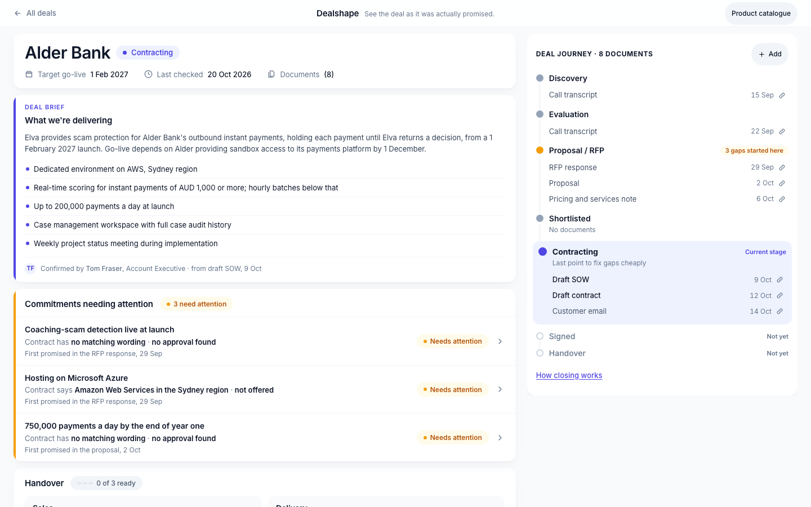

# Dealshape

**Catch deal surprises before you sign.**

Dealshape compares what the customer was promised with the contract and your product catalogue. It shows which commitments are missing, different or unsupported, with the source evidence. For B2B Sales and Delivery teams.

The customer remembers the proposal, the RFP answers and the calls; the contract says what it says. Dealshape reads a deal's paper trail before signing and again at handover, and shows what we're delivering, which commitments need attention and why, what people have noted about them, and which documents were checked. When the handover is complete it locks that record for Delivery, Customer Success and Support.

It flags two kinds of mismatch:
- **promises stronger than the company authorised;**
- **promises that never made it into the contract.**

It also says what it could not check: if the model proposed findings that failed verification against the documents, the count is shown.

**Design principle:** visibility, not workflow. It has no tasks, assignees, approvals or risk scores.

*Demonstrated on fictional deals with a complete capability catalogue.* It is a local prototype, built in October 2026 to learn how to design, build and evaluate an AI system end to end.



## What it shows (Alder Bank, the fictional demo deal)

| Commitment | What the customer was told | What the paperwork says |
| --- | --- | --- |
| Coaching-scam detection live at launch | Promised in the RFP response | The contract has no matching wording, and the catalogue needs a named approval that nobody recorded |
| Hosting on Microsoft Azure | Promised in the RFP response | The contract says Amazon Web Services in the Sydney region, and Azure isn't offered |
| 750,000 payments a day by the end of year one | Promised in the proposal | No matching wording in the contract, and no approval found |

One commitment can carry several gaps, and they close independently. An approval does not put a promise into the contract.

## A second scenario: two vendors' catalogues, one pipeline

**Noma Journeys** (fictional, Singapore) is buying an AI customer-support assistant from **Aivuna** (fictional), to answer guests' questions about bookings, changes and refunds by chat and email from 1 February 2027. Dealshape reviews that software sale, not the assistant. The same commitment-checking applies to assistants used by financial-services operations teams, and to any vendor whose promises can be set against a catalogue and a contract.

| Commitment | What the paperwork says | In the demo |
| --- | --- | --- |
| Support in 12 languages at launch | The proposal and RFP promise 12; the draft contract specifies four. Aivuna's catalogue supports 12 | A revised contract specifying 12 closes it: **Closed by documents** |
| A dedicated launch specialist for the first 30 days, at no extra charge | A named internal exception is required and missing; the service is also missing from the contract and SOW | The revised pricing note supplies the exception, but the contract commitment is still missing, so it **still needs attention at handover** |
| AI answers customers' phone calls at launch | Aivuna's catalogue lists chat and email only, and the SOW says the same | A person records that Noma agreed to launch on chat and email: **Addressed by note**, the mismatch still visible |

**Each deal is checked against its own vendor's catalogue.** The four earlier deals use Elva's catalogue and kept every hash, finding and freshness state when the second one was added. **What this shows, and what it doesn't:** two vendors' catalogues run through one detection pipeline, and **the detection prompt still names the original vendor.** The model read the Aivuna deal once, at a cost of $0.0755, and found the designed gaps plus one legitimate extra. That is one demonstration run, not an accuracy measurement, and it does not show that any vendor's catalogue would work. Details: `data/noma_journeys/BRIEF.md`.

## How it works

1. **Read.** The deal's documents (Markdown, text, PDF, Word, Excel, PowerPoint) are grouped by deal stage. **The stage comes from the documents:** a signed contract marks the deal Signed. Nobody sets the stage by hand.
2. **Detect (the model).** One model call reads the paper trail with the capability catalogue. It proposes each gap with the promise quoted word for word, the catalogue entry, and the contract clause or the missing wording.
3. **Verify (code).** Every quote and citation is checked mechanically. A finding that fails a check is kept on record and never shown. On screen, **"What we found" shows only what code verified.** The model's own explanation is labelled "AI-written summary".
4. **Recheck (code).** Add an updated document, such as a named exception or an aligned SOW, and the check runs again. A gap closes only when the new paperwork shows it no longer holds, and the screen says which document closed it. A failed check stores nothing.
5. **Notes are a person's word, not proof.** A note can keep a commitment open with context, or mark it "Addressed by note". Either way it looks different from "Closed by documents", stays in the record, and reopens if the documents change.
6. **Hand over.** Sales and Delivery each write a note, the signed contract is uploaded, and completing the handover locks a read-only record. The record states honestly what is still open.

## Where the AI comes in, and where it doesn't

The model does the reading. It maps sales wording to the catalogue and the contract, which hand-written rules could not do on unseen deals (see the results below). Code does the deciding: a finding exists only if its quotes and citations check out, and it closes only when code can show the claim no longer holds. **The model never closes anything.** What code cannot check is the model's reading of a paraphrase. That is what the sealed runs measure.

**Alder Bank and Noma Journeys are demo deals. Neither was part of a sealed evaluation** (only Coral Pay and Atlas Remit were; Harbour Bank is the development deal). The published results below describe the versions that were tested.

## Results, version 1 (rules decide): first sealed deal, 10 Oct 2026

Coral Pay was written before the build and sealed: no code read it until a single run per configuration. Full analysis: [`docs/RESULTS_coral_pay_2026-10-10.md`](docs/RESULTS_coral_pay_2026-10-10.md).

| | Target | Result |
| --- | --- | --- |
| Extraction recall, firm commitments | ≥ 90% | **14/14** |
| Language (exploratory / conditional / firm) | ≥ 85% | **14/14** |
| Quote validity | 100% | **100%** |
| Precision after the housekeeping filter | ≥ 85% | **74%: missed** |
| Planted issues found exactly by the rules | 3 of 3 | **1 of 3** (the other 2 reached review as *Needs evidence*) |
| False flags on clean commitments | 0 | **2 of 4** |
| Agent v2 earns a place (pre-registered rule) | — | **No**: right in substance on 2 cases, unsupported in form, over the time and cost bounds |
| Resolution scenarios (development deal, real model) | 5 of 5 | **5 of 5** |

**The finding that matters:** a single model call over all the documents found **all 3** planted issues with no false flags; the rules found 1. The rules' vocabulary was tuned on development wording and did not generalise. What the pipeline adds is not better detection but evidence-bound findings, recheck, decisions that never change findings, and a handoff record. The next design is model-led detection with rule-checked evidence.

## Results, version 2 (model detects, code verifies): second sealed deal, 10 Oct 2026

After the Coral Pay result, detection was rebuilt: one model call proposes each finding with exact quotes and catalogue or contract citations, and code rejects any finding whose quotes or citations do not check out. Tuned on the four development deals (including Coral Pay, now seen), frozen and committed, then run once on **Atlas Remit**, a deal written and sealed by an isolated agent that never saw v2's code. Full analysis: [`docs/RESULTS_atlas_remit_v2_2026-10-10.md`](docs/RESULTS_atlas_remit_v2_2026-10-10.md).

| | Pre-registered target | v2 | One-call baseline |
| --- | --- | --- | --- |
| Labelled issues found | ≥ 80% | **8 of 8** | 8 of 8 |
| False flags | ≤ 1 | **0** | 1 (a real timing point outside the labels) |
| Reply complete and parsed | required | **yes** | truncated at the token limit |
| Every finding mechanically checked | — | **yes** | no (free text, scored by hand) |

**Read it straight:** v2 did not out-detect a single prompt; it matched it, and its findings are verifiable and structured enough for the app to recheck and close. One deal and eight targets is a small sample.

## Known limitations (stated plainly)

- **Paraphrase and unseen wording.** The v1 rules found 1 of 3 planted issues on the first sealed deal. v2 found 8 of 8 on the second, but one deal with 8 targets is a small sample.
- **The results describe detection v2 as tested** (`v2_version` 2, 10 Oct). Any later change to the detection prompt or verifier raises the version, and those results would then no longer describe the running version.
- **Wording, not legal meaning.** "No matching wording found" means exactly that. It is not a legal reading of the contract.
- **A recheck does not re-read unchanged documents** when extraction settings change. Each review records which settings every document was read under.
- **Adding a capability to a catalogue marks every deal checked against it "Review out of date"** until it is checked again. That is safe, but noisy on many deals. Only Elva's catalogue can be added to in the app; Aivuna's is a published file.
- **The verifier matches words, not meaning.** A finding is shown only if its quotes are word for word in the documents and its claim passes plain text checks: a promised value must appear in the promise, a "not offered" value must appear nowhere in that region's catalogue entry, a missing phrase (at most six words) must appear nowhere in the contract. So a real concern that the model words loosely is refused (Alder's one refused finding added "with no exceptions" to the promise), a paraphrased contract clause can read as missing, and a catalogue that lists an unavailable option explicitly would stop a "not offered" finding about it. For that reason Aivuna's catalogue states that voice is not offered in its top-level unlisted rule, not as a listed entry. The count of refused findings is shown on the deal page.
- **The detection prompt still names the original vendor.** It says "the vendor, Elva", and was not changed for the Aivuna deal, because changing it would raise `v2_version` and invalidate every saved reading. Two vendors' catalogues run through one pipeline; what the Aivuna runs showed is recorded in `data/noma_journeys/BRIEF.md`.
- **Signed paperwork.** A signed contract marks the deal Signed; its wording is not compared with the drafts.
- **Formats.** PDF text layer only (no OCR); Excel by stored values only; PowerPoint slide text only.
- **Synthetic data.** Every deal is fictional and was written for this build.
- **Not in this build:** live Drive or CRM connectors (documents carry a Drive link field), user accounts, post-signature tracking, legal advice.

## How it was tested

- **Sealed evaluation.** Two deals were written and sealed before the code that tested them, and each configuration ran once. The labels, documents and seals are never edited, and nothing was tuned on them.
- **Automated tests:** 677 Python tests and 57 front-end tests. They include regression checks on extraction, five resolution scenarios, "a failed check stores nothing", and "no internal key reaches any screen".
- **Reviewers:** a Head of Growth (6 Oct), a COO (15 Oct) and a Delivery lead (16 Oct), plus one outside UI review. Two reviewers in different roles asked for visibility, not workflow, and the product was rebuilt around that. **Not yet done: an unaided test** with someone who has never seen the product.

## Run it locally

```
python -m venv .venv && source .venv/bin/activate
pip install -r requirements.txt
cd frontend && npm ci && cd ..
python reset_demo.py
python -m uvicorn api:app --host 127.0.0.1 --port 8000
# second terminal
cd frontend && npm run dev     # open http://127.0.0.1:5173
```

The demo opens on the deals list with no API key. Reading a new or changed contract or customer document needs `ANTHROPIC_API_KEY` in the server's terminal. The browser never sees it.

## Where to look

| File | What it is |
| --- | --- |
| `DECISIONS.md` | Every design choice, the alternative rejected, and why |
| `LEARNING_LOG.md` | What I learned, got stuck on and got wrong |
| `docs/RESULTS_*.md` | The two sealed runs in full |
| `docs/DEMO_SCRIPT_2026-10-20_alder.md` | The four-minute demo (Elva, Alder Bank) |
| `docs/DEMO_SCRIPT_2026-10-20_noma.md` | The second demo (Aivuna, Noma Journeys) |
| `docs/` | Briefs, the integrity inspection, specs, design references |

## Credits and honesty

All companies, people, products and deal terms are fictional. TRM Labs, Chainalysis, BioCatch, Zendesk, Freshdesk, Microsoft Azure and Amazon Web Services are real product or company names, used in the fictional catalogues and deals for realism only. No partnership is claimed. Aivuna and Noma Journeys are fictional and unrelated to any real business of a similar name.

Built with Claude Code as build partner. Claude drafted the fictional documents, fixtures and briefs from my direction, and the screen designs started in Google Stitch. The product decisions, labels and evaluation design are mine.
